# Welcome to Sumi

Sumi is a quiet place to read Markdown. This page uses every kind of formatting the reader understands, so you can see how each one looks. Open the contents with <kbd>Ctrl</kbd> <kbd>\\</kbd> to jump around.

## Reading

| Action | Shortcut |
| :--- | :--- |
| Open a file | <kbd>Ctrl</kbd> <kbd>O</kbd>, or drag one into the window |
| Text size | <kbd>Ctrl</kbd> <kbd>+</kbd> &nbsp;/&nbsp; <kbd>Ctrl</kbd> <kbd>−</kbd> &nbsp;/&nbsp; <kbd>Ctrl</kbd> <kbd>0</kbd> |
| Paper, Sepia, Night | <kbd>Ctrl</kbd> <kbd>T</kbd> |
| Next typeface | <kbd>Ctrl</kbd> <kbd>Shift</kbd> <kbd>F</kbd> |
| Contents | <kbd>Ctrl</kbd> <kbd>\\</kbd> |
| Find on the page | <kbd>Ctrl</kbd> <kbd>F</kbd> |
| Print or save as PDF | <kbd>Ctrl</kbd> <kbd>P</kbd> |

Everything else lives under **Aa** in the top-right corner. When you save the file in another program, the page updates by itself and keeps your place.

## Text

A paragraph is just a paragraph. Words can be **bold**, *italic*, or ***both at once***. You can ~~strike something out~~, mark a phrase as <mark>highlighted</mark>, or write `inline code` in the middle of a sentence. Chemists get H<sub>2</sub>O and mathematicians get x<sup>2</sup>.

A single line break inside a paragraph is ignored, so you can wrap
lines in your editor however you like. End a line with two spaces  
to force a break, like this one.

Typographic characters come through exactly as written: “curly quotes,” an en dash for 1990–2024, an em dash — for asides — and an ellipsis…

## Links

- A link to the web: [Fontsource](https://fontsource.org) opens in your browser.
- A bare address becomes a link too: https://example.com
- A link to another Markdown file opens it here: [On Walking](On%20Walking.md)
- A link to a heading on this page scrolls to it: [jump to Code](#code)

## Headings

Headings build the contents list. There are six levels:

### Third level

#### Fourth level

##### Fifth level

###### Sixth level

## Lists

Bulleted lists can nest:

- Morning
  - Open the window
  - Make tea
    - Loose leaf, if there's time
- Afternoon
- Evening

Numbered lists can nest and can start anywhere:

1. Choose a book
2. Find a chair by the window
   1. Turn off notifications
   2. Put the phone in another room
3. Read

<!-- -->

7. This list starts at seven
8. And carries on from there

Task lists show what's done:

- [x] Install Sumi
- [x] Open a Markdown file
- [ ] Try every typeface
- [ ] Read something long, slowly

## Quotes

> Reading is to the mind what exercise is to the body.
>
> — Joseph Addison

Quotes can hold other things, including more quotes:

> A few notes from the margin:
>
> - Read the first page twice
> - Don't skip the footnotes
>
> > The second reading is the real one.

## Code

Inline code sits softly in the line, like `git status`. Longer code gets a block of its own. Hover over a block to copy it.

```python
import time

def breathe(seconds: int = 4) -> None:
    """In, hold, out, slowly."""
    for phase in ("in", "hold", "out"):
        print(phase)
        time.sleep(seconds)
```

```javascript
const pages = ["Morning", "Noon", "Night"];
pages.forEach((page, i) => console.log(`${i + 1}. ${page}`));
```

Blocks without a language work the same way:

```
$ sumi notes.md
```

Very long lines scroll sideways instead of wrapping:

```text
This line is deliberately long so you can see that code blocks scroll horizontally rather than breaking the layout or wrapping in awkward places.
```

## Tables

Columns can be aligned left, centre or right:

| Theme | Feeling | Best for | Contrast |
| :---- | :-----: | :------- | -------: |
| Paper | Clean, bright | Daylight reading | High |
| Sepia | Warm, like old pages | Long evenings | Medium |
| Night | Soft and low | When the room is dark | Gentle |

## Images

Images next to the file load just as they would in a folder:



## Dividers

Three dashes on their own line make a quiet divider.

---

Like that.

## Collapsible sections

<details>
<summary>Click to read more</summary>

Hidden text stays tucked away until it's wanted. It can hold **formatting**, lists and `code` like everything else.

</details>

## Odds and ends

Characters that Markdown would normally treat as formatting can be shown literally with a backslash: \*not italic\*, \# not a heading, and \`not code\`.

Accented and other characters display normally: café, naïve, Ångström, Zürich, smørrebrød.

That's everything. Close your other windows, sit back, and read.
